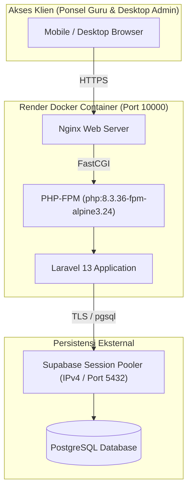
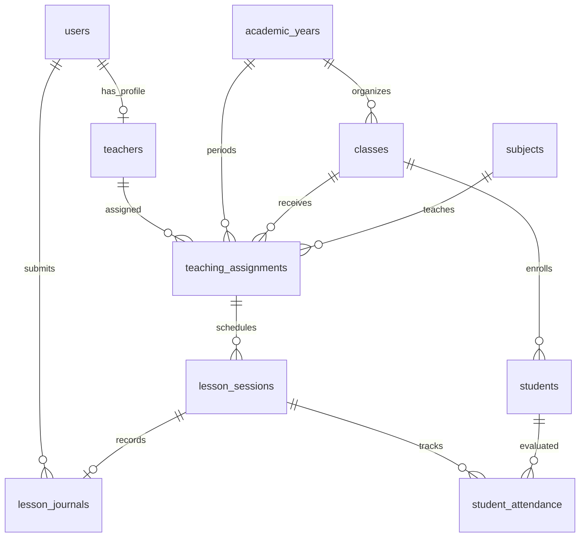

# Dokumentasi Rinci Implementasi Fase 2: Setup Fondasi & Arsitektur

**Status:** Selesai Disiapkan (Menunggu Persetujuan Terpisah untuk Migrasi ke Supabase)  
**Tanggal:** 29 Oktober 2026  
**Aplikasi:** Aplikasi Absensi, Jurnal Mengajar, dan Laporan Operasional SMK Yapparindo  
**Zona Waktu Sistem:** WITA (`Asia/Makassar` / UTC+8)

---

## 1. Pendahuluan dan Ruang Lingkup

Dokumen ini memberikan laporan terperinci mengenai seluruh komponen teknis yang dibangun pada **Fase 2 (Setup Fondasi & Arsitektur)**. Berdasarkan pemetaan pada [docs/PROJECT_STATUS.md](PROJECT_STATUS.md), Fase 2 merupakan pelaksanaan awal dari **Tahap 4 (Sub-langkah 1, 2, 3, dan 13)** pada [PROMPT.md](../PROMPT.md).

### A. Yang Dikerjakan pada Fase 2:
1. Pembuatan aturan perlindungan Git ([.gitignore](../.gitignore)) dan container ([.dockerignore](../.dockerignore)).
2. Inisialisasi kerangka kerja aplikasi **Laravel 13** dan styling **Tailwind CSS v4** dengan bundler **Vite v6**.
3. Penyiapan file container **[Dockerfile](../Dockerfile)** berbasis multi-stage build yang dipatok ke patch keamanan resmi untuk deployment Render.
4. Konfigurasi koneksi database **Supabase PostgreSQL** via **Session Pooler (IPv4)** dengan enkripsi TLS mandatori.
5. Pembuatan 6 file migration skema basis data fondasi (11 tabel utama).
6. Pembuatan 10 model Eloquent di [app/Models/](../app/Models/) dengan relasi lengkap dan type-casting.
7. Pembuatan seeder data sintetis ([SyntheticDataSeeder.php](../database/seeders/SyntheticDataSeeder.php)) dengan pengamanan password tanpa hardcoded.
8. Pembuatan file pengujian unit dan fitur di [tests/](../tests/) yang dieksekusi secara in-memory (SQLite) tanpa menyentuh Supabase.
9. Pembuatan file dependensi terkunci ([composer.lock](../composer.lock)) dan audit keamanan dependensi (`composer audit`).

### B. Batasan Ketat (Yang Dilarang & Ditahan di Fase 2):
* **Tidak menjalankan migrasi ke Supabase:** Eksekusi migrasi ke cloud Supabase memerlukan persetujuan terpisah dan rencana backup/rollback.
* **Tidak membuat antarmuka form:** Form absensi siswa, jurnal kelas, dan dashboard baru dibangun pada Fase 3.
* **Tidak membuat Service Worker & IndexedDB:** Fitur PWA offline baru diimplementasikan pada Fase 3 setelah modul online inti siap.
* **Tidak ada data riil sekolah:** Seluruh data seeder bersifat sintetis (nama contoh dan domain `@example.test`).
* **Tidak ada deployment langsung:** Tidak ada service Render yang dibuat atau dihubungkan ke GitHub.

---

## 2. Arsitektur Sistem & Spesifikasi Komponen



### A. Rincian Versi dan Verifikasi Keamanan

Sesuai panduan [.agents/skills/security-supply-chain-guardian/SKILL.md](../.agents/skills/security-supply-chain-guardian/SKILL.md):

| Komponen | Versi yang Dipatok | Sumber Resmi Verifikasi | Catatan Keamanan |
|---|---|---|---|
| **Base Image PHP** | `php:8.3.36-fpm-alpine3.24` | Docker Hub Official Library (`hub.docker.com/_/php`) & [php.net/archive/2026.php](https://www.php.net/archive/2026.php) | Memuat patch resmi 21 Oktober 2026 untuk mitigasi kerentanan kritis RCE: **CVE-2026-109618** dan **CVE-2026-109619**. |
| **Laravel Framework** | `^13.0` (Terkunci `v13.39.0` di `composer.lock`) | [laravel.com/docs/releases](https://laravel.com/docs/releases) | Mengikuti siklus tahunan Laravel dengan masa dukungan 18 bulan bug fixes dan 24 bulan security fixes. |
| **Tailwind CSS** | `4.3.3` (Dipatok persis di `package.json`) | [tailwindcss.com/blog](https://tailwindcss.com/blog) & NPM Registry | Generasi Tailwind v4 berbasis CSS modern terintegrasi `@tailwindcss/vite` v4.3.3. |
| **Vite Bundler** | `^6.0.0` | NPM Registry | Build asset frontend berhasil terkompilasi (`public/build/assets/`). |
| **Composer CLI** | `v2.10.3` | [getcomposer.org](https://getcomposer.org) | Audit `composer audit --locked` menghasilkan **0 vulnerabilities**. |

---

## 3. Rincian Skema Basis Data Fondasi (Migration)

Terdapat 6 file migrasi di folder [database/migrations/](../database/migrations/) yang mendefinisikan 11 tabel utama:



### Tabel-Tabel Fondasi yang Dibuat:

1. **`users` (`0001_01_01_000000_create_users_table.php`)**
   * Menyimpan akun otentikasi aplikasi.
   * *Kolom:* `id`, `name`, `email` (unique), `username` (unique), `password` (hashed), `role` (`admin` / `teacher`), `is_active`, `remember_token`, `timestamps`.
   * *Pendukung:* Menyertakan tabel bawaan Laravel `password_reset_tokens` dan `sessions` (untuk driver sesi database).
2. **`cache` & `cache_locks` (`0001_01_01_000001_create_cache_table.php`)**
   * Digunakan untuk driver cache database (`CACHE_STORE=database`) agar tidak bergantung pada filesystem sementara (*ephemeral*) Render.
3. **`jobs`, `job_batches`, `failed_jobs` (`0001_01_01_000002_create_jobs_table.php`)**
   * Digunakan untuk antrean pekerjaan asinkron (`QUEUE_CONNECTION=database`).
4. **Tabel Akademik (`2026_10_29_000001_create_foundation_academic_tables.php`):**
   * **`academic_years`:** Menyimpan periode tahun ajaran (misal: "2026/2027"), semester (`ganjil` / `genap`), `start_date`, `end_date`, dan status aktif `is_active`.
   * **`teachers`:** Menyimpan profil guru yang terikat ke `users.id` (1-to-1), `nip` (unique, nullable), `name`, `gender` (`L`/`P`), `phone`, `status` (`tetap`/`kontrak`/`honor`), dan `is_active`.
   * **`classes`:** Rombongan belajar/kelas, `name` (misal: "X TKJ 1"), `grade_level` (`X`, `XI`, `XII`), `major` (program keahlian), dan `academic_year_id`.
   * **`students`:** Profil siswa, `class_id`, `nisn` (unique, nullable), `nis`, `name`, `gender` (`L`/`P`), dan `is_active`.
   * **`subjects`:** Data mata pelajaran, `code` (unique, nullable), `name`, dan `is_active`.
   * **`teaching_assignments`:** Penugasan mengajar yang mengikat `teacher_id`, `class_id`, `subject_id`, dan `academic_year_id`. Dilengkapi **Unique Constraint** `['teacher_id', 'class_id', 'subject_id', 'academic_year_id']` untuk mencegah penugasan ganda.
5. **Tabel Absensi & Jurnal (`2026_10_29_000002_create_foundation_attendance_tables.php`):**
   * **`lesson_sessions`:** Sesi pembelajaran aktual pada tanggal tertentu di WITA, mencakup `teaching_assignment_id`, `date`, `time_start`, `time_end`, `period_start` (jam ke-N), `period_end`, dan `status` (`scheduled`, `completed`, `cancelled`).
   * **`lesson_journals`:** Jurnal mengajar per sesi (1-to-1 dengan `lesson_sessions`), mencakup `meeting_number` (pertemuan ke-N), `topic` (materi pembelajaran), `notes`, `submitted_at` (tanda waktu final submitted), dan `submitted_by`.
   * **`student_attendance`:** Catatan kehadiran individual per siswa per sesi.
     * *Enum Status:* `H` (Hadir), `S` (Sakit), `I` (Izin), `A` (Alpa), `T` (Training), `DW` (Daily Worker).
     * *Constraint Unik Mutlak:* `unique(['lesson_session_id', 'student_id'])` sehingga seorang siswa **mustahil** memiliki dua catatan kehadiran pada sesi kelas yang sama.
6. **`notifications` (`2026_10_29_000003_create_notifications_table.php`)**
   * Tabel notifikasi standar Laravel (`id` UUID, `type`, `notifiable`, `data`, `read_at`). Digunakan untuk mengirim notifikasi ke akun guru saat terjadi resolusi konflik sinkronisasi di mana catatan di server telah dibuat/diubah oleh admin (*server-wins*).

> [!NOTE]
> Sesuai batasan Fase 2, tabel `daily_agendas` (agenda harian guru/pegawai) dan `staff_attendance` (kehadiran pegawai) **tidak dibuat** pada migrasi ini.

---

## 4. Struktur Model Eloquent (`app/Models/`)

Model Eloquent diimplementasikan secara bersih dan mengikuti prinsip *Minimal Code Engineering*:

1. [User.php](../app/Models/User.php): Otentikasi, hidden password/remember_token, casting password ke `hashed`, relasi `hasOne(Teacher::class)`.
2. [Teacher.php](../app/Models/Teacher.php): Relasi `belongsTo(User::class)` dan `hasMany(TeachingAssignment::class)`.
3. [AcademicYear.php](../app/Models/AcademicYear.php): Relasi `hasMany(Classroom::class)`.
4. [Classroom.php](../app/Models/Classroom.php): Explicit table `$table = 'classes'`, relasi `belongsTo(AcademicYear::class)` dan `hasMany(Student::class, 'class_id')`.
5. [Student.php](../app/Models/Student.php): Relasi `belongsTo(Classroom::class, 'class_id')` dan `hasMany(StudentAttendance::class)`.
6. [Subject.php](../app/Models/Subject.php): Entitas mata pelajaran.
7. [TeachingAssignment.php](../app/Models/TeachingAssignment.php): Relasi ke Teacher, Classroom, Subject, AcademicYear, dan `hasMany(LessonSession::class)`.
8. [LessonSession.php](../app/Models/LessonSession.php): Relasi `belongsTo(TeachingAssignment::class)`, `hasOne(LessonJournal::class)`, dan `hasMany(StudentAttendance::class)`.
9. [LessonJournal.php](../app/Models/LessonJournal.php): Relasi `belongsTo(LessonSession::class)` dan `belongsTo(User::class, 'submitted_by')`.
10. [StudentAttendance.php](../app/Models/StudentAttendance.php): Explicit table `$table = 'student_attendance'`, relasi `belongsTo(LessonSession::class)` dan `belongsTo(Student::class)`.

---

## 5. Kebijakan Seeder & Keamanan Password

File [SyntheticDataSeeder.php](../database/seeders/SyntheticDataSeeder.php) dirancang dengan mematuhi prinsip *Zero Hardcoded Secrets*:

1. **Password Administrator:**
   * Diambil dari environment variable: `$adminPassword = env('ADMIN_INITIAL_PASSWORD');`.
   * **Pencegahan Kegagalan Keamanan:** Jika `ADMIN_INITIAL_PASSWORD` kosong atau tidak didefinisikan, seeder **segera membatalkan eksekusi** dengan melempar exception:
     ```php
     if (empty($adminPassword)) {
         throw new \RuntimeException('ADMIN_INITIAL_PASSWORD belum diset di environment. Seeder dihentikan demi keamanan.');
     }
     ```
2. **Password Akun Guru:**
   * Dibuat secara acak saat runtime menggunakan `Str::random(16)`.
   * Password acak ini dicetak ke konsol satu kali agar penguji dapat mencatatnya, dan **tidak pernah ditulis ke file atau log**.
3. **Domain Email:**
   * Seluruh alamat email menggunakan domain standar pengujian `@example.test` (contoh: `admin@example.test`, `budi.santoso@example.test`), bukan domain sekolah asli.

---

## 6. Konfigurasi Lingkungan & Konektivitas Database

### A. Template `.env.example`
File [.env.example](../.env.example) disiapkan untuk kebutuhan pengembang lokal tanpa membocorkan nilai rahasia:
* `APP_NAME="Absensi Yapparindo"`
* `APP_ENV=local`
* `APP_DEBUG=true`
* `APP_TIMEZONE=Asia/Makassar`
* `DB_CONNECTION=pgsql`
* `DB_HOST=aws-0-ap-southeast-1.pooler.supabase.com`
* `DB_PORT=5432`
* `DB_DATABASE=postgres`
* `DB_USERNAME=postgres.your-project-ref`
* `DB_PASSWORD=your-database-password`
* `DB_SCHEMA=public`
* `DB_SSLMODE=require`
* `SESSION_DRIVER=database`
* `CACHE_STORE=database`
* `QUEUE_CONNECTION=database`
* `ADMIN_INITIAL_PASSWORD=` (Placeholder password admin awal)

### B. Konfigurasi Produksi Render ([RENDER_DEPLOYMENT.md](RENDER_DEPLOYMENT.md))
Telah didokumentasikan secara tegas bahwa di **Render Dashboard Environment**, variabel berikut **WAJIB** diset secara manual:
* `APP_ENV=production`
* `APP_DEBUG=false` *(Mencegah kebocoran stack trace database ke publik)*
* `DB_SSLMODE=require` *(Enkripsi TLS wajib)*

---

## 7. Rincian Pengujian Otomatis

Seluruh tes dikonfigurasi melalui [phpunit.xml](../phpunit.xml) untuk menggunakan database SQLite in-memory (`:memory:`) dan driver mock (`CACHE_STORE=array`, `SESSION_DRIVER=array`, `QUEUE_CONNECTION=sync`). Tes tidak pernah mengakses jaringan eksternal atau Supabase.

### Hasil Pengujian PHPUnit 11:
```text
PHPUnit 11.5.57 by Sebastian Bergmann and contributors.

Runtime:       PHP 8.5.12
Configuration: phpunit.xml

.......                                                             7 / 7 (100%)

Time: 00:00.988, Memory: 38.50 MB

OK (7 tests, 40 assertions)
```

### Kasus Uji yang Terpenuhi:
1. `Tests\Unit\MigrationFoundationTest::test_foundation_tables_are_defined_in_migrations`: Memvalidasi keberadaan definisi 11 tabel fondasi.
2. `Tests\Unit\MigrationFoundationTest::test_daily_agendas_and_staff_attendance_are_not_present`: Memvalidasi tabel di luar cakupan Fase 2 tidak terbentuk.
3. `Tests\Unit\SeederSecurityTest::test_no_hardcoded_passwords_in_seeder`: Memvalidasi tidak ada password lama atau domain riil di seeder.
4. `Tests\Unit\SeederSecurityTest::test_seeder_throws_when_admin_password_env_is_empty`: Memvalidasi mekanisme proteksi exception seeder.
5. `Tests\Feature\DatabaseFoundationMigrationTest::test_database_migrations_create_all_foundation_tables_and_exclude_daily_agendas`: Mengeksekusi migrasi secara riil ke SQLite in-memory dan memeriksa `Schema::hasTable()`.
6. `Tests\Feature\DatabaseFoundationMigrationTest::test_seeder_succeeds_when_admin_initial_password_is_set`: Mengeksekusi seeder secara riil dengan password admin terisi, memverifikasi hash bcrypt, 3 guru sintetis, dan 5 siswa sintetis.
7. `Tests\Feature\DatabaseFoundationMigrationTest::test_seeder_fails_when_admin_initial_password_is_empty`: Mengeksekusi seeder dengan password admin kosong dan memvalidasi `RuntimeException`.

---

## 8. Status Pemeriksaan Repositori

1. **Pemeriksaan Secret:** Pemeriksaan menggunakan `grep` membuktikan tidak ada string password riil, password hardcoded lama, atau token yang tersimpan di dalam repositori.
2. **Pemeriksaan File Tersembunyi:** Tidak ada file `.env`, `.env.local`, atau kredensial yang masuk ke staging area. File [.gitignore](../.gitignore) aktif memblokir varian `.env*`, `vendor/`, `node_modules/`, `public/build/`, dan `bootstrap/cache/*.php`.
3. **Status Git Saat Ini:** Seluruh file telah di-*stage* dan siap untuk dikomit setelah Anda selesai meninjau dokumen ini.

---

## 9. Langkah Selanjutnya (Menunggu Persetujuan Pengguna)

1. **Pemeriksaan & Konfirmasi Komit:** Pengguna memeriksa dokumen ringkasan ini dan memberikan izin untuk melakukan komit lokal atas file yang telah di-stage.
2. **Penyusunan Rencana Backup & Rollback Supabase:** Membuat prosedur backup data dan skrip rollback schema sebelum eksekusi migrasi Supabase dijalankan di masa mendatang.
3. **Pemberian Persetujuan Terpisah untuk Migrasi:** Menjalankan migrasi terkontrol ke Supabase PostgreSQL setelah kredensial dan rencana backup disetujui.
4. **Melangkah ke Fase 3:** Implementasi modul autentikasi guru/admin, pengelolaan data master, dan fitur absensi kelas (online & offline PWA).
